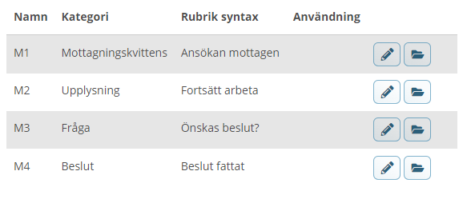
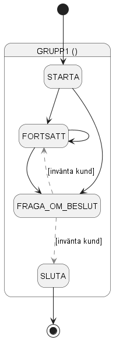

# KHTK (Kundhändelsetypskatalog)

_En specifikation för kundhändelsetypskataloger._

Detta är en specifikation av ett JSON-baserat filformat vars syfte är att möjliggöra strukturerad/maskinläsbar
dokumentation av den struktur som ligger till grund för en verksamhets kundåterkoppling som den definieras
av [Mina ärenden](https://www.dataportal.se/sv/datasets/6_71657/mina-arenden).

Dokumentationen ska vara ett stöd för de arbetar för att kunna möta behovet av kundåterkoppling i en verksamhet,
såväl ur ett kommunikativt som ett tekniskt perspektiv.

Filformatet innehåller:

- __Formatet för den kommunikation som ska ske (kundhandelsemallar och parametrar).__

- __Vilka processer detta sker (processgrupper) och hur processerna fungerar (steg).__

- __Filformatet har också stöd för att dokumentera vilka system som är inblandade i en viss kundhändelsemall eller processteg (system)
  eftersom integrationen med dessa kan påverkas av ändringar i definitionen av processerna och formuleringarna.__

Filformatet är helt självständigt och har [Fyrvaktaren](https://codeberg.org/jordbruksverket/fyrvaktaren)
och Fyren som referensimplementationer.

Filformatet uttrycks för närvarande som en OpenAPI-specifikation, men skulle kunna övergå till ett
rent JSON-schema i framtiden, eftersom det inte ingår några REST-anrop i specifikationen.